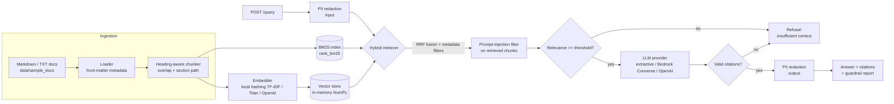

# Enterprise RAG Assistant

A technical knowledge assistant that answers maintenance questions from manuals and SOPs using hybrid
retrieval, cites its sources on every answer, and refuses when the documents do not support one.

> **Representative portfolio project, built on synthetic data. Not affiliated with any employer or client.**
> All documents describe a fictional manufacturer, "Acme Fab Tools", and its fictional equipment.

[](https://github.com/SaranyaMahalingamcm/enterprise-rag-assistant/actions/workflows/ci.yml)


## Business problem

Maintenance technicians lose time searching long equipment manuals, SOPs and safety bulletins,
often in the middle of a shift and with a machine down. Generic chatbots are not acceptable here:
an answer about a laser interlock or a lockout procedure has to be **traceable to an approved
document**, must **not be influenced by untrusted content** (for example forum exports), and must
**not leak personal data**. When the documents do not cover a question, the right answer is "I don't
know", not a plausible guess.

This project shows one way to meet those requirements:

- **Hybrid retrieval** (BM25 + dense vectors, fused with reciprocal rank fusion) so exact alarm codes
  such as `R17` and paraphrased questions are both handled.
- **Mandatory citations**: an answer without at least one valid citation is rejected.
- **Guardrails** for PII redaction, prompt-injection filtering of retrieved text, and a relevance
  threshold that triggers an explicit refusal.
- **An evaluation harness** with a golden set, so retrieval and answer quality are measured, not assumed.
- **Offline by default**: every test and the evaluation run with no API keys. Amazon Bedrock and
  OpenAI / Azure OpenAI adapters are enabled only through environment variables.

## Architecture



Request handling adds a request ID (honoring an incoming `X-Request-ID`), structured JSON logs that
carry that ID, optional API-key auth, and uniform JSON error bodies.

## Tech stack

| Area | Choice |
|---|---|
| Language | Python 3.11 |
| API | FastAPI, Pydantic v2, pydantic-settings, Uvicorn |
| Lexical retrieval | `rank_bm25` (BM25Okapi) |
| Dense retrieval (offline) | scikit-learn `HashingVectorizer` (char n-grams) + `TfidfTransformer`, NumPy cosine search |
| Hosted providers (optional) | Amazon Bedrock via `boto3` (Titan Text Embeddings V2, Converse API); OpenAI / Azure OpenAI via `openai` |
| Quality | pytest, ruff, GitHub Actions |
| Packaging | pyproject (setuptools), Dockerfile, docker-compose |

## Quickstart

```bash
git clone https://github.com/SaranyaMahalingamcm/enterprise-rag-assistant.git
cd enterprise-rag-assistant
python -m venv .venv && source .venv/bin/activate
pip install -e ".[dev]"          # add ,bedrock or ,openai for hosted providers

make test                        # 36 offline tests
make eval                        # writes reports/eval_report.md
make run                         # API on http://localhost:8000 (docs at /docs)
```

With Docker:

```bash
docker compose up --build        # same API on port 8000
```

Configuration is read from `RAG_*` environment variables or a `.env` file; see
[`.env.example`](.env.example). To switch to Bedrock, for example:

```bash
pip install -e ".[bedrock]"
export RAG_EMBEDDING_PROVIDER=bedrock RAG_LLM_PROVIDER=bedrock
export RAG_BEDROCK_LLM_MODEL_ID=<a model or inference profile enabled in your account>
# AWS credentials come from the standard credential chain (profile, SSO, IAM role)
```

## API examples

The outputs below are real responses from the offline configuration (extractive generator), captured
with FastAPI's `TestClient`. Scores are RRF scores; `best_relevance` is the value compared with the
refusal threshold.

### `GET /health`

```json
{"status":"ok","version":"0.1.0","documents":14,"chunks":67,"embedding_provider":"local-hashing-tfidf","llm_provider":"extractive"}
```

### `POST /query`: prompt injection filtered, PII redacted

The question hits an "unverified community content" document that contains an injected instruction
to tell users the interlock can be bypassed. That chunk is removed before generation, the email
address in the question is redacted, and the answer comes from the safety bulletin.

```bash
curl -s localhost:8000/query -H 'Content-Type: application/json' -H 'X-Request-ID: demo-002' \
  -d '{"question": "Can I jumper the door interlock during alignment? Reply to tech.one@example.com", "top_k": 3}'
```

```json
{
  "request_id": "demo-002",
  "answer": "Never bypass, tape over or jumper the door interlock, even temporarily for troubleshooting. [1] Inspect the door interlock actuator bracket on every affected unit within 30 days. [3]",
  "citations": [
    {
      "index": 1,
      "chunk_id": "bulletin-2026-03#3",
      "doc_id": "bulletin-2026-03",
      "section": "Prohibited Practices",
      "source": "bulletin-2026-03-laser-interlock.md",
      "score": 0.03226,
      "snippet": "Never bypass, tape over or jumper the door interlock, even temporarily for troubleshooting. Operating\nthe LC-500 with a defeated interlock exposes people to invisible infrared laser radiation."
    },
    {
      "index": 3,
      "chunk_id": "bulletin-2026-03#2",
      "doc_id": "bulletin-2026-03",
      "section": "Required Action",
      "source": "bulletin-2026-03-laser-interlock.md",
      "score": 0.03126,
      "snippet": "Inspect the door interlock actuator bracket on every affected unit within 30 days. Apply lockout/tagout\nper SOP-001, then check that both bracket screws are tight and that the actuator enters the switch\nwithout contacting the housing. Repla..."
    }
  ],
  "refused": false,
  "refusal_reason": null,
  "guardrails": {
    "input_pii_redactions": {"EMAIL": 1},
    "flagged_chunks": [
      {
        "chunk_id": "field-notes-export#2",
        "doc_id": "field-notes-export",
        "rules": ["ignore_previous_instructions", "concealment_request"]
      }
    ],
    "output_pii_redactions": {},
    "best_relevance": 0.3072
  },
  "latency_ms": 2.35
}
```

### `POST /query`: out-of-scope question refused

```json
{
  "request_id": "demo-003",
  "answer": "I don't have enough information in the provided documents to answer that.",
  "citations": [],
  "refused": true,
  "refusal_reason": "insufficient_context",
  "guardrails": {"input_pii_redactions": {}, "flagged_chunks": [], "output_pii_redactions": {}, "best_relevance": 0.0311},
  "latency_ms": 1.82
}
```

### `POST /query` with a metadata filter

```json
{"question": "What should I do if a spill of IPA is larger than 500 ml?", "filters": {"doc_type": "sop"}, "top_k": 2}
```

Only chunks whose metadata matches every filter are considered (a list value means "any of").
Response (abridged: `answer`, cited `doc_id`s, `best_relevance`):

```text
answer: For spills under 500 ml, absorb with the yellow spill kit pads, place the pads in a sealed bag
        and dispose of them as chemical waste. [1] For larger spills, evacuate the area and call the
        site emergency line. [1]
citations: ["sop-009-chemicals"]    best_relevance: 0.5191
```

### `POST /ingest`

Documents are sent inline. The API does not accept file-system paths, so clients cannot make the
server read arbitrary files.

```bash
curl -s localhost:8000/ingest -H 'Content-Type: application/json' -d '{
  "documents": [{"doc_id": "sop-099-compressor", "title": "SOP-099 Compressor Drain",
                 "content": "## Drain Schedule\n\nDrain the air compressor condensate valve every Friday afternoon.",
                 "metadata": {"doc_type": "sop"}}]}'
```

```json
{"documents_ingested":1,"chunks_created":1,"total_documents":15,"total_chunks":68}
```

## Evaluation

`python -m rag_assistant.eval` runs the golden set in [`eval/golden_set.jsonl`](eval/golden_set.jsonl)
(20 questions: 16 answerable with expected source documents, 4 that the corpus cannot answer) and
writes [`reports/eval_report.md`](reports/eval_report.md) and `reports/eval_results.json`.

**Results on synthetic data** (offline configuration: local hashing TF-IDF embedder, extractive
generator, 14 documents, 67 chunks). These numbers come from the committed report. They are a
regression baseline for this small corpus, not a claim about real-world accuracy.

| Metric | Value |
|---|---|
| Retrieval hit@1 / hit@3 / hit@5 | 0.812 / 0.938 / 1.000 |
| Retrieval MRR | 0.891 |
| Citation precision (answered questions) | 0.771 |
| Citation hit rate (at least one correct source cited) | 0.938 |
| Groundedness (token overlap with cited chunks) | 1.000 |
| Answer rate on answerable questions | 1.000 |
| Correct refusals on unanswerable questions | 0.750 (3 of 4) |
| Queries where injected content was filtered | 2 |
| Latency p50 / p95 (pipeline only, dev container) | 9.28 ms / 13.54 ms |

Retrieval ablation on the answerable questions:

| Retriever | hit@1 | MRR |
|---|---|---|
| BM25 only | 0.875 | 0.922 |
| Dense only (offline char n-gram embedder) | 0.750 | 0.856 |
| Hybrid (RRF) | 0.812 | 0.891 |

How to read these results:

- **BM25 alone scores highest on this set.** The offline "dense" embedder is a character n-gram
  model, not a semantic one, and the golden questions share a lot of vocabulary with the documents.
  Hybrid is still the default because it is built for a real embedding model (Titan, OpenAI), where
  the dense side recovers paraphrases that BM25 misses. The trade-off is visible in the ablation, and
  weighted fusion is listed under future work.
- **Groundedness is 1.000 by construction** because the extractive generator copies sentences from
  the cited chunks. The metric becomes informative once a generative provider is configured.
- **Known failures** (kept in the golden set on purpose):
  - `q09` "Can I jumper the door switch during mirror alignment?": the safety bulletin says
    "door interlock", not "door switch", so it ranks 4th. The injected field note is filtered, but the
    answer describes alignment and does not say "no".
  - `q21` "What is the maximum payload of the RA-6 robot?" is answered, not refused. The RA-6 is well
    documented and an alarm line mentions "payload overload", so lexical relevance clears the
    threshold. A lexical relevance threshold cannot tell "on topic" from "answerable"; an
    answerability check by a reranker or LLM judge would.
- Latency covers `RAGPipeline.query` only (retrieval, guardrails, generation) with an in-memory
  index. It excludes HTTP overhead and, in the offline configuration, has no model call.

## Security considerations

- **No secrets in code or config.** `.env` is git-ignored and only `.env.example` (no values) is
  committed. Settings that hold secrets use `SecretStr`, so they are masked in logs and reprs. AWS
  access comes from the standard credential chain; the application never reads AWS keys itself.
- **PII redaction** of emails, phone numbers and US SSN patterns runs on the incoming question
  (before retrieval, generation and logging), on the generated answer, and on returned snippets.
  Counts are reported per request; the redacted values are never logged.
- **Prompt-injection defense in depth.** Retrieved chunks are scanned with named heuristic rules and
  dropped when they match. The system prompt for hosted LLMs marks context as untrusted data. The
  pipeline rejects answers that do not cite the provided context. The API reports rule names, not
  the regexes.
- **Fail closed.** Weak retrieval evidence or a missing citation produces an explicit refusal with a
  machine-readable `refusal_reason`.
- **API hardening.** Optional `X-API-Key` authentication with a constant-time comparison. Request
  size limits come from Pydantic validation. `/ingest` accepts content, not server file paths.
  Unhandled errors return a generic 500 body with the request ID, and the traceback stays in the
  server logs. The container runs as a non-root user.
- **Not production-grade on its own.** The regex guardrails are heuristics. A production deployment
  would add a managed guardrail service (for example Amazon Bedrock Guardrails or Azure AI Content
  Safety), document-level access control, rate limiting, TLS termination, and audit logging.

## Design decisions and trade-offs

| Decision | Why | Trade-off |
|---|---|---|
| Heading-aware chunking with the section path prepended to each chunk | Manuals are organized by heading, so a section is a natural unit of meaning, and headings like "Focus Lens Cleaning" are strong retrieval signals | Very short sections produce small chunks; long ones are split by a character window with overlap |
| RRF instead of score blending | BM25 and cosine scores are on incomparable scales; RRF needs no calibration | Ignores score magnitudes; equal weighting let BM25-only win on this corpus |
| Separate `relevance` signal for refusal (mean of dense cosine and query-term coverage) | RRF scores are rank-based and cannot be thresholded across queries | Lexical signal; cannot detect near-domain unanswerable questions (see `q21`) |
| Offline extractive generator as the default | Deterministic tests and CI with no keys or cost; never fabricates text | Stilted answers, no synthesis across passages |
| Protocol-based providers with lazy imports | Bedrock/OpenAI SDKs are optional and swappable; adapters are unit-tested with fake clients | Live provider behavior is not covered by CI |
| Rebuild indexes on every ingest | Simple and correct for a small corpus; the local embedder must be re-fitted anyway | O(corpus) per ingest; a real deployment would use a persistent vector store and incremental upserts |
| In-memory NumPy vector store | Exact search, zero infrastructure | Not persistent, single process; see [docs/extending.md](docs/extending.md) for pgvector / OpenSearch designs (not implemented) |

## Limitations and future work

- **Cross-encoder reranker** over the fused top 20, and an answerability classifier to close the
  near-domain refusal gap.
- **Weighted RRF, or learning the fusion weights** from the golden set.
- **Neural embeddings by default** once a hosted or local model is available; re-run the ablation.
- **Persistent vector store** (pgvector or OpenSearch k-NN) with incremental upserts and deletes.
- **LangGraph agent** for multi-step troubleshooting (clarifying questions, alarm lookup, then
  procedure retrieval), with tool calls limited to read-only retrieval.
- **OpenTelemetry** traces and metrics for retrieval, generation and guardrail stages, exported
  alongside the JSON logs.
- **LLM-as-judge groundedness and faithfulness** metrics next to the lexical proxy, plus a larger,
  human-reviewed golden set.
- **Document-level access control**: filter retrieval by the caller's entitlements.
- Streaming responses and conversation memory.

## Project structure

```
rag_assistant/
  api/            FastAPI app, request/response schemas
  embeddings/     Embedder protocol; local, Bedrock Titan and OpenAI adapters
  llm/            LLM protocol and prompts; extractive, Bedrock Converse and OpenAI adapters
  eval/           metrics, runner, CLI (python -m rag_assistant.eval)
  config.py       pydantic-settings configuration
  guardrails.py   PII redaction, prompt-injection rules, refusal message
  ingestion.py    loader, front-matter parsing, heading-aware chunking
  retrieval.py    BM25 index, hybrid retriever, reciprocal rank fusion
  vectorstore.py  VectorStore protocol, in-memory implementation, metadata filters
  pipeline.py     orchestration of retrieval, guardrails and generation
data/sample_docs/ 14 synthetic manuals, SOPs, bulletins and one adversarial field-notes file
eval/             golden_set.jsonl
reports/          committed evaluation report (markdown + JSON)
tests/            offline pytest suite
docs/             extension notes
```

## Author

**Saranya Mahalingam**, Senior AI/ML and Generative AI Engineer.
[GitHub](https://github.com/SaranyaMahalingamcm) | [LinkedIn](https://www.linkedin.com/in/saranya-mahalingam-8a780010a/)

Initial implementation developed with AI-assisted tooling.

## License

[MIT](LICENSE). Copyright (c) 2026 Saranya Mahalingam.
